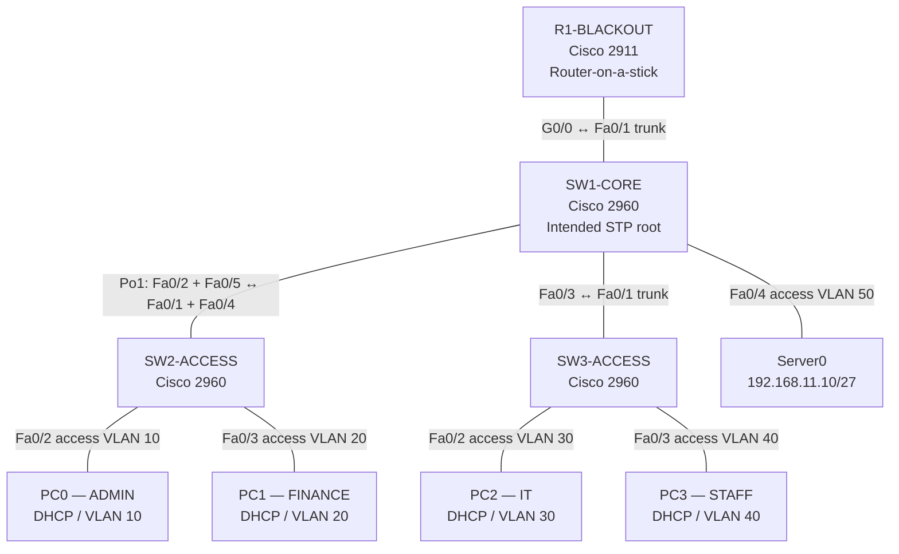

# Operation Blackout — Enterprise Campus Network

**Project 01 | Networking Infrastructure Labs**

Operation Blackout is a Cisco Packet Tracer enterprise campus network built for a fictional organization, Blackout Technologies. The lab demonstrates VLAN-based segmentation, IPv4 subnetting, router-on-a-stick inter-VLAN routing, DHCP, Layer 2 trunking, LACP EtherChannel, Spanning Tree Protocol (STP), SSH management, and access-port security.

> **Status:** Core implementation and reported final verification complete. Packet Tracer screenshots, raw command outputs, and the `.pkt` lab file should be added before treating this repository as a fully evidenced portfolio artifact.

## Objectives

- Segment departments using VLANs and IPv4 subnets.
- Route between VLANs through 802.1Q router subinterfaces.
- Provide DHCP to client VLANs and static addressing for infrastructure.
- Aggregate parallel switch links using LACP.
- Make the core switch the intended STP root bridge.
- Restrict trunk VLAN propagation and use SSH instead of Telnet.
- Limit access-port MAC learning and shut down confirmed unused ports.
- Test connectivity, a physical EtherChannel member failure, and a real VLAN trunking fault.

## Topology



The two parallel SW1–SW2 physical links form one logical Layer 2 EtherChannel, `Port-channel1`. STP sees the bundle as a logical port.

## VLAN and IPv4 plan

| VLAN | Name | Network | Default gateway | Use |
|---:|---|---|---|---|
| 10 | ADMIN | `192.168.10.0/26` | `192.168.10.1` | PC0 |
| 20 | FINANCE | `192.168.10.64/26` | `192.168.10.65` | PC1 |
| 30 | IT | `192.168.10.128/26` | `192.168.10.129` | PC2 |
| 40 | STAFF | `192.168.10.192/26` | `192.168.10.193` | PC3 |
| 50 | SERVERS | `192.168.11.0/27` | `192.168.11.1` | Server0 |
| 99 | MANAGEMENT | `192.168.11.32/27` | `192.168.11.33` | Switch management SVIs |

### Known endpoint addresses

| Device | VLAN | Address | Assignment |
|---|---:|---|---|
| PC0 | 10 | `192.168.10.11` | DHCP |
| PC1 | 20 | `192.168.10.75` | DHCP |
| PC2 | 30 | `192.168.10.139` | DHCP |
| PC3 | 40 | `192.168.10.203` | DHCP |
| Server0 | 50 | `192.168.11.10/27` | Static |
| SW1-CORE | 99 | `192.168.11.34/27` | Static SVI |
| SW2-ACCESS | 99 | `192.168.11.35/27` | Static SVI |
| SW3-ACCESS | 99 | `192.168.11.36/27` | Static SVI |

The DHCP pools cover VLANs 10, 20, 30 and 40, with `.1` through `.10` excluded in each `/26` subnet. Record the exact DHCP pool and exclusion commands from the saved device configuration rather than reconstructing them from memory.

## Main implementation features

- **VLANs:** VLANs 10, 20, 30, 40, 50 and 99 are created on the three switches.
- **Inter-VLAN routing:** R1-BLACKOUT uses subinterfaces on `G0/0` with 802.1Q encapsulation and the gateway addresses listed above.
- **DHCP:** Router DHCP pools serve the four user VLANs.
- **Trunking:** Required VLANs are explicitly allowed on the router-facing and SW1–SW3 trunks; the SW1–SW2 Port-channel trunk allows `10,20,30,40,50,99`.
- **EtherChannel:** LACP bundles SW1 `Fa0/2` and `Fa0/5` with SW2 `Fa0/1` and `Fa0/4`.
- **STP:** SW1-CORE was configured as root primary for VLANs `10,20,30,40,50,99`. VLAN 10 root election was directly inspected on all three switches.
- **Management:** Switch SVIs are in VLAN 99; SSH is configured on all three switches.
- **Port security:** The four PC-facing ports use one maximum secure MAC, sticky learning, and `restrict` violation mode.
- **Unused ports:** Confirmed unused access ports were shut down. Port inventory should be revisited if the topology changes.

## Verification summary

The operator reports that the final checklist passed:

- PC0 can ping PC1, PC2, PC3 and Server0.
- PC0 can reach all three switch management addresses.
- EtherChannel Po1 is up and both members are bundled after the failure test was restored.
- SW1-CORE is the intended STP root for the six project VLANs.
- SSH works on all three switches.
- Port security is enabled on all four PC-facing access ports.
- Confirmed unused ports have been shut down.
- Configurations have been saved.

Add actual screenshots or pasted outputs to `evidence/` so reviewers can independently inspect this result. The directly captured STP output in the working notes was for VLAN 10; capture the remaining VLANs if you want evidence for the all-six-VLAN claim.

## Troubleshooting case: VLAN 20 excluded from EtherChannel trunk

**Symptom:** PC0 could reach several endpoints, but could not reach PC1 in VLAN 20. PC1 could reach its own gateway, but the router could not successfully ping PC1.

**Investigation:** The PC's access port was in VLAN 20 and up/up. The router had a VLAN 20 subinterface and the EtherChannel was up. The SW1 trunk output exposed an allowed VLAN typo: `10,29-30,40,50,99`, which excluded VLAN 20.

**Root cause:** VLAN 20 traffic was not permitted across the SW1–SW2 logical trunk.

**Correction:**
```text
interface port-channel 1
 switchport trunk allowed vlan 10,20,30,40,50,99
```

**Verification:** VLAN 20 was shown as allowed, active, and forwarding on the Port-channel, and the operator confirmed connectivity was restored.

This is a useful operational lesson: an interface can be up and a VLAN can exist on switches while an incorrect trunk allow-list still prevents that VLAN from crossing the link.

## EtherChannel member-failure test

One physical member cable, SW1 `Fa0/5` to SW2 `Fa0/4`, was disconnected for a controlled test. The captured status showed:

- SW1: `Po1(SU)`, `Fa0/2(P)`, `Fa0/5(D)`
- SW2: `Po1(SU)`, `Fa0/1(P)`, `Fa0/4(D)`
- `show interfaces port-channel 1` reported the logical interface up/up with `Fa0/2` as its remaining member.

The operator confirmed end-to-end connectivity continued to work. The cable was then restored and both members returned to the bundle. Attach before/after screenshots or command outputs in `evidence/`.

## Repository structure

```text
project-01-operation-blackout/
├── README.md
├── topology.md
├── addressing-plan.md
├── verification.md
├── troubleshooting.md
├── configs/
│   └── configuration-capture-guide.md
└── evidence/
    └── README.md
```

## Scope and limitations

This is a simulated campus network, not a production deployment. No Internet uplink, firewall, wireless LAN, IPv6 implementation, or external DNS service is claimed. Security controls are introductory and should not be interpreted as a complete production hardening baseline. Do not commit passwords, private keys, or other secrets.

## Reproduce the lab

1. Open the saved Packet Tracer `.pkt` file using a compatible Packet Tracer version.
2. Inspect the topology and VLAN/IP plan.
3. Review `configs/configuration-capture-guide.md` and capture the relevant `show` outputs.
4. Run the tests in `verification.md`.
5. Review `troubleshooting.md` and reproduce the VLAN allow-list fault only after saving a known-good copy.
6. Save the known-good `.pkt` file and device configurations.

## Learning outcomes

This project practices VLAN design, IPv4 subnetting, router-on-a-stick, DHCP, trunk troubleshooting, LACP, STP root election, SSH management, port security, controlled failure testing, and technical documentation.
